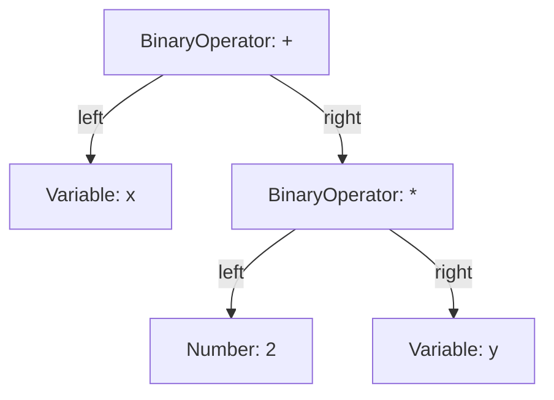
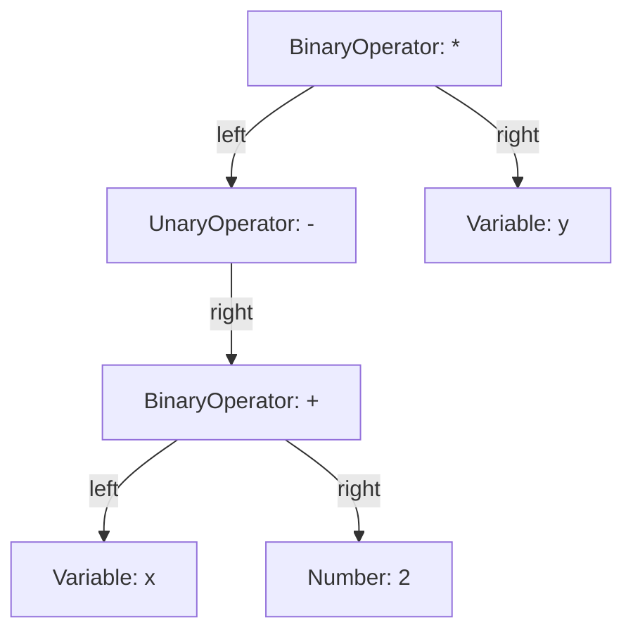

# MINAX Compiler

This is a compiler for converting the MINAX math expression strings to the computable objects.

## String Convention

For convenience, we make the following conventions for the MINAX strings :
* The MINAX string is composed of the following tokens : "Number", "Identifier", "Operator", "LParen", "RParen", "Comma", "End".
  
Among them, identifier contains variables names functions names.Operator currently contains "+", "-", "*", "/", "=", "==", "!=", "<", ">", "<=", ">=".

* Each token is separated by a space, which is more convenient for the parser.The front-end input device will ensure the implementation of this convention.

For example, the MINAX string "1 + 2 * 3" will be converted to the following tokens : "1", "+", "2", "*", "3".the string "1 \*2" is an invalid MINAX string because there is no space between "\*" and "2".

## Step1 : Lexical Analysis

### We design the following structure for tokens :

```c++

struct Token {
    TokenKind kind;
    std::string text;
    std::size_t position;
    double number = 0.0;
    OperatorId op = OperatorId::None;
};

```

* Tokenkind which is mentioned above includes "Number", "Identifier", "Operator", "LParen", "RParen", "Comma", "End".

```c++

enum class TokenKind {
    Number,
    Identifier,
    Operator,
    LParen,
    RParen,
    Comma,
    End
};

```

* Text is the original string of the token.
* Position is the position of the token in the original string, which is used for error reporting.
* Number is the number value of the token, which is only used for number tokens.
* Op is the operator id of the token, which is only used for operator tokens and extensible.It contains all the operators mentioned above.

```c++

enum class OperatorId {
    None,

    Add,
    Subtract,
    Multiply,
    Divide,

    Equal,
    NotEqual,
    Greater,
    Less,
    GreaterEqual,
    LessEqual
};

```

With the above preparations, we can start to implement the lexical analysis.

### Assistant functions

```c++
    const std::unordered_map<std::string, OperatorInfo>& operatorTable();
    bool isSpace(char c);
    void lexicalError(std::size_t position, const std::string& message);
```

* operatorTable() is a function that returns the operator table, which is a hash table that maps operator names to operator ids.This table can easily be extended to support more operators and simplify the implementation of the lexical analysis.
Here is the design of related data structure :
```c++

enum class OperatorCategory {
    Arithmetic,
    Comparison
};

enum class Associativity {
    Left,
    Right,
    NonAssociative
};

struct OperatorInfo {
    OperatorId id;
    OperatorCategory category;
    int precedence;
    Associativity associativity;
};

```

Example of the implementation of the operator table : 
```c++
{
    "+",
    {
        OperatorId::Add,
        OperatorCategory::Arithmetic,
        20,
        Associativity::Left
    }
},
{
    "*",
    {
        OperatorId::Multiply,
        OperatorCategory::Arithmetic,
        30,
        Associativity::Left
    }
},
{
    ">=",
    {
        OperatorId::GreaterEqual,
        OperatorCategory::Comparison,
        10,
        Associativity::NonAssociative
    }
}

```

* isSpace() is a function that returns true if the character is a space character.

* lexicalError() is a function that reports a lexical error.It takes the position of the error and the error message as parameters.

### Tokenize

Becase of the simplicity of the MINAX language, we can implement the lexical analysis in a simple way.We just need to split the string into tokens by spaces."(" and ")" are the easiest tokens to deal with. operators are also easy to deal with, because they are all saved in the operator table.Numers and identifiers are more complicated, because they can contain letters and numbers. We can use regular expressions to deal with them, which is a powerful tool for string processing and supported by C++.As for the invalid MINAX strings, we can use the lexicalError() function to report them.Don't forget to add the "End" token at the end of the string.

Here is the implementation of the tokenize() function :
```c++

std::vector<Token> Lexical::tokenize() const {
    static const std::regex numberPattern(
        R"(([0-9]+(\.[0-9]*)?|\.[0-9]+)([eE][+-]?[0-9]+)?)"
    );

    static const std::regex identifierPattern(
        R"([A-Za-z_][A-Za-z0-9_]*)"
    );

    const auto& operators = operatorTable();

    std::vector<Token> tokens;
    std::size_t position = 0;

    while (position < words.size()) { 
        while (position < words.size() && isSpace(words[position])) {
            position++;
        }
        if (position == words.size()) {
            break;
        }

        std::size_t begin = position;
        while (position < words.size() && !isSpace(words[position])) {
            position++;
        }
        std::string text = words.substr(begin, position - begin);

        if (text == "(") {
            tokens.push_back(Token{
                TokenKind::LParen,
                "(",
                begin
            });
            continue;
        }

        if (text == ")") {
            tokens.push_back(Token{
                TokenKind::RParen,
                ")",
                begin
            });
            continue;
        }

        if (text == ",") {
            tokens.push_back(Token{
                TokenKind::Comma,
                ",",
                begin
            });
            continue;
        }

        const auto opIt = operators.find(text);
        if (opIt != operators.end()) {
            tokens.push_back(Token{
                TokenKind::Operator,
                text,
                begin,
                0.0,
                opIt->second.id,
            });
            continue;
        }

        if (std::regex_match(text, numberPattern)) {
            double value = 0.0;

            std::istringstream input(text);
            input.imbue(std::locale::classic());

            if (!(input >> value) || !std::isfinite(value)) {
                lexicalError(
                    begin,
                    "Number cannot be represented as a finite double : " +
                    text
                );
            }

            tokens.push_back({
                TokenKind::Number,
                text,
                begin,
                value
            });
            continue;
        }

        if (std::regex_match(text, identifierPattern)) {
            tokens.push_back({
                TokenKind::Identifier,
                text,
                begin
            });
            continue;
        }
        
        else {
            lexicalError(begin, "Invalid token : " + text);
        }
    }
    tokens.push_back({
        TokenKind::End,
        "",
        position
    });
    return tokens;
}

```

### Testing

We can use the following commands to test the lexical analysis(Mingw64) :

```bash

g++ -std=c++17 -Iinclude src/Lexical.cpp test/LexicalTest.cpp -o lexicaltest
./lexicaltest

```

You can append your own test cases to the LexicalTest.cpp file or delete the existing ones.

## Step2 : Syntactic Analysis
The syntactic analysis is the second step of the MINAX compiler. It is responsible for parsing the tokens generated by the lexical analysis and building an abstract syntax tree(AST).

Given that the implementation of function is much more complex, for a function consists of comma, parentheses, operators, even expressions. We can start only with numbers, identifiers and operators which includes unary and binary operators.It is extensible, much easier to implement and builds a framework for sunsequent analysis. 

### Data Structure and API

We design ASTNode and SyntaxKind to represent the structure of the AST.
```c++

enum class SyntaxKind {
    Number,
    Variable,
    BinaryOperator,
    UnaryOperator,
};

struct ASTNode {
    SyntaxKind kind = SyntaxKind::Number;
    std::string text;
    std::size_t position = 0;
    double number = 0.0;
    OperatorId op = OperatorId::None;
    std::unique_ptr<ASTNode> left;
    std::unique_ptr<ASTNode> right;
};

```
we make the agreement that the unary operator always uses its right node.

Through the lexical analysis, we now get an array of tokens. We design a pointer "current" to the current token, and the following API to assist the parsing process :

```c++

    const Token& peek() const;
    Token advance();
    bool match(TokenKind kind);
    Token expect(TokenKind kind);
    void syntaxError(std::size_t position, const std::string& message);

```

* peek() is a function to view the current token without advancing.
* advance() is a function to consume the current token and advace to the next token.If the current token is End, it will not advance to avoid the token array out of bounds.
* match() is a function to match the current token with the specified type.If the match is successful, it will consume the current token and return true.Otherwise, it will not advance and return false.
* expect() is a function to require a specific type.If the current token matches the specified type, it will consume the current token and return it.Otherwise, it will report a syntax error.
* syntaxError() is a function to throw a syntax error.

### Parse

Let's first take a look at the overall composition of the token array. The array starts with a number or identifier or a unary operator, followed by a sequence of binary operators and numbers or identifiers, and always ends with an End token.So we can use the following code to parse the token array :

```c++

std::unique_ptr<ASTNode> Syntax::parse() {
    auto node = parseExpression(0);

    expect(TokenKind::End);

    return node;
}

```

It is easily understood with the overall structure of token array. Now the difficulty lies in the inplementation of parseExpression().
To better adapt the priority of operators, we use an argument "minPrecedence" to represent the priority of the current operator.In function parse() we set minPrecedence to 0, which means that the current operator has the lowest priority.


We can first consider the most fundamental tokens, which are number or identifier without unary operators before them. We can parse them with the following code :
```c++ 

std::unique_ptr<ASTNode> Syntax::parsePrimary() {
    const auto token = peek();

    switch (token.kind) {
        case TokenKind::Number: {
            auto node = std::make_unique<ASTNode>();

            node->kind = SyntaxKind::Number;
            node->text = token.text;
            node->position = token.position;
            node->number = token.number;

            advance();

            return node;
        }

        case TokenKind::Identifier: {
            advance();
            auto node = std::make_unique<ASTNode>();
            node->kind = SyntaxKind::Variable;
            node->text = token.text;
            node->position = token.position;

            return node;
        }

        case TokenKind::LParen: {
            advance();

            auto node = parseExpression(0);

            expect(TokenKind::RParen);

            return node;
        }

        default: {
            syntaxError(
                token.position,
                "Expected primary expression but got " +
                tokenKindToString(token.kind) +
                " ('" + token.text + "')"
            );
        }
    }
}

```

Now the expressions like "1", "var", "( 3 )", "( var )" can be parsed.

However, we still need to consider the unary operators before them, like "-1", "+ var", "- ( 3 )", "- - ( var )". Actually, we can easily parse them with the paersePrimary() function by parseUnary() function.We only need to identify the current token whether a possible unary operator, which can only be plus sign or minus sign.If it is not, we can directly call parsePrimary() to parse the primary expression.If it is, we only need to recursively call parseUnary() to further parse and set the result to the right node.

Here is the code :

```c++

std::unique_ptr<ASTNode> Syntax::parseUnary() {
    const auto token = peek();

    if (token.kind == TokenKind::Operator &&
        (token.op == OperatorId::Add ||
         token.op == OperatorId::Subtract)) {

        advance();

        auto node = std::make_unique<ASTNode>();

        node->kind = SyntaxKind::UnaryOperator;
        node->text = token.text;
        node->position = token.position;
        node->op = token.op;

        node->right = parseUnary();

        return node;
    }

    return parsePrimary();
}

```

Now expressions like "-1", "+ var", "- ( 3 )", "- - ( var )" can be parsed.

With all these above, we can finally implement parseExpression(int minPrecedence) :

Take a look at this example : "- 1 + 2 * 3".In fact, we apparently konw that the first token in a correct token array must be a number or identifier or a unary operator.So we can parse the first token with parseUnary(), for if it is not a unary operator, it will call parsePrimary() to parse it.

```c++

    auto left = parseUnary();

```

After that, it must be followed by a binary operator or an End token if it is correct(We don't consider function calls and constraint sentenses here).So if the current token is not a binary operator, we can derectly return the left node.Othetrwise, we can make a binary operator node which its left node is the left node we just parsed. Then the question lies in the right node of the binary operator node.

"+", "-", "*", "/" are left associative operators.For example, "1 + 2 + 3" is equivalent to "1 + ( 2 + 3 )" or "( 1 + 2 ) + 3".However, "1 - 2 - 3" is only equivalent to "( 1 - 2 ) - 3".So we use the uniform left associativity to parse them.But how? Now the argument "minPrecedence" is used to solve this problem. When we parse the right node, we set the nextminPrecedence to the current operator's precedence + 1.If the right operator's precedence is less than the current operator's precedence + 1, we can directly parse the right node.Otherwise, we need to parse the right node recursively. For example, "1 + 2 + 3" is equivalent to "( 1 + 2 ) + 3", because when we parse the right node, we set the nextminPrecedence to 20 + 1 = 21(plus sign's precedence is set to 20. See details at lexical analysis). When the pointer points to the second plus sign, it's precedence is 20, which is less than 21, so we can directly return "2" as the right node but not " ( 2 + 3 ) ".Let's see anothrer example : "1 + 2 * 3".When we parse the right node, we set the nextminPrecedence to 20 + 1 = 21.When the pointer points to the star sign, it's precedence is 30, which is greater than 21, so we need to parse the right node recursively, then return " ( 2 * 3 ) " as the right node. After get the right node, we set left to the binary operator node, the start the loop to iteratively parse.

These characters are obscure, so we now show the code :

```c++

std::unique_ptr<ASTNode> Syntax::parseExpression(int minPrecedence) {
    auto left = parseUnary();

    while (true) {
        const auto token = peek();

        if (token.kind != TokenKind::Operator) {
            break;
        }

        const auto& operators = operatorTable();
        const auto it = operators.find(token.text);

        if (it == operators.end()) {
            syntaxError(
                token.position,
                "Unknown operator '" + token.text + "'"
            );
        }

        const auto& info = it->second;

        if (info.category != OperatorCategory::Arithmetic) {
            break;
        }

        if (info.precedence < minPrecedence) {
            break;
        }

        if (info.associativity == Associativity::NonAssociative) {
            syntaxError(
                token.position,
                "Non-associative arithmetic operators "
                "are not supported by this parser"
            );
        }

        advance();

        const int nextMinPrecedence = info.associativity == Associativity::Left ? info.precedence + 1 : info.precedence;

        auto right = parseExpression(nextMinPrecedence);

        auto node = std::make_unique<ASTNode>();

        node->kind = SyntaxKind::BinaryOperator;
        node->text = token.text;
        node->position = token.position;
        node->op = info.id;

        node->left = std::move(left);
        node->right = std::move(right);

        left = std::move(node);
    }

    return left;
}

```

See some examples of the syntax tree to better understand the whole process.

#### 1. 四则运算：`x + 2 * y`



#### 2. 括号与一元负号：`- ( x + 2 ) * y`



You can test by following commands :
```bash

g++ -std=c++17 -Iinclude test/SyntaxSimpleTest.cpp src/Syntax.cpp src/Lexical.cpp -o syntaxsimpletest
./syntaxsimpletest

```

### Functions, Reductions, and Constraints

We finally reach the most important and difficult part of the parser.Fortunately, we have already built a very extensible and good fundamental structure.

we add some new syntax kinds and data structures :

``` c++

enum class SyntaxKind {
    Number,
    Variable,
    BinaryOperator,
    UnaryOperator,

    // Newly added
    FunctionCall,
    Reduction
};

// Newly added
enum class ReductionKind {
    Sum,
    Product
};

struct ASTNode {
    SyntaxKind kind = SyntaxKind::Number;
    std::string text;
    std::size_t position = 0;
    double number = 0.0;
    OperatorId op = OperatorId::None;
    std::unique_ptr<ASTNode> left;
    std::unique_ptr<ASTNode> right;

    // Newly added
    std::vector<std::unique_ptr<ASTNode>> arguments;

    // Newly added
    ReductionKind reduction = ReductionKind::Sum;

    // Newly added
    std::string indexName;

    // Newly added
    std::size_t indexPosition = 0;

    // Newly added
    std::unique_ptr<ASTNode> lower;
    std::unique_ptr<ASTNode> upper;
    std::unique_ptr<ASTNode> body;
};

// Newly added
struct Constraint {
    std::unique_ptr<ASTNode> left;

    OperatorId relation = OperatorId::None;

    std::unique_ptr<ASTNode> right;

    std::string text;
    std::size_t position = 0;
};

class Syntax {
private:
    // Newly added
    std::unique_ptr<ASTNode> parseFunctionCall(const Token& name);

    // Newly added
    std::unique_ptr<ASTNode> parseReduction(const Token& name);

public:
    // Newly added
    Constraint parseConstraint();
};

```

Just show the code below.If you understand the code above, you can easily understand the rest of the code :

```c++

Constraint Syntax::parseConstraint() {
    Constraint constraint;

    constraint.left = parseExpression(0);

    const auto token = peek();

    if (token.kind != TokenKind::Operator) {
        syntaxError(
            token.position,
            "Expected comparison operator (=, !=, >, <, >=, <=)"
        );
    }

    const auto& operators = operatorTable();
    const auto it = operators.find(token.text);

    if (it == operators.end() ||
        it->second.category != OperatorCategory::Comparison) {
        syntaxError(
            token.position,
            "Expected comparison operator but got '" +
            token.text + "'"
        );
    }

    constraint.relation = it->second.id;
    constraint.text = token.text;
    constraint.position = token.position;

    advance();

    constraint.right = parseExpression(0);

    const auto& next = peek();

    if (next.kind == TokenKind::Operator) {
        const auto nextIt = operators.find(next.text);

        if (nextIt != operators.end() &&
            nextIt->second.category == OperatorCategory::Comparison) {
            syntaxError(
                next.position,
                "Chained comparisons are not supported; "
                "split them into separate constraints"
            );
        }
    }

    expect(TokenKind::End);

    return constraint;
}

std::unique_ptr<ASTNode> Syntax::parseFunctionCall(const Token& name) {
    auto node = std::make_unique<ASTNode>();

    node->kind = SyntaxKind::FunctionCall;
    node->text = name.text;
    node->position = name.position;

    if (match(TokenKind::RParen)) {
        return node;
    }

    while (true) {
        auto argument = parseExpression(0);
        node->arguments.push_back(std::move(argument));

        if (!match(TokenKind::Comma)) {
            break;
        }
    }

    expect(TokenKind::RParen);

    return node;
}

std::unique_ptr<ASTNode> Syntax::parseReduction(const Token& name) {
    auto node = std::make_unique<ASTNode>();

    node->kind = SyntaxKind::Reduction;
    node->text = name.text;
    node->position = name.position;

    node->reduction =
        name.text == "sum"
            ? ReductionKind::Sum
            : ReductionKind::Product;

    const auto indexToken = expect(TokenKind::Identifier);

    node->indexName = indexToken.text;
    node->indexPosition = indexToken.position;

    expect(TokenKind::Comma);

    node->lower = parseExpression(0);

    expect(TokenKind::Comma);

    node->upper = parseExpression(0);

    expect(TokenKind::Comma);

    node->body = parseExpression(0);

    expect(TokenKind::RParen);

    return node;
}

```

We can call them in function parsePrimary() :

```c++

    case TokenKind::Identifier: {
        advance(); 

        if (match(TokenKind::LParen)) {

            if (token.text == "sum" || token.text == "prod") {
                return parseReduction(token);
            }

            return parseFunctionCall(token);
        }

        auto node = std::make_unique<ASTNode>();

        node->kind = SyntaxKind::Variable;
        node->text = token.text;
        node->position = token.position;

        return node;
    }

```

You can test by running the following command :

```bash

g++ -std=c++17 -Iinclude test/SyntaxComplicatedTest.cpp src/Syntax.cpp src/Lexical.cpp -o syntaxcomplicatedtest
./syntaxcomplicatedtest

```